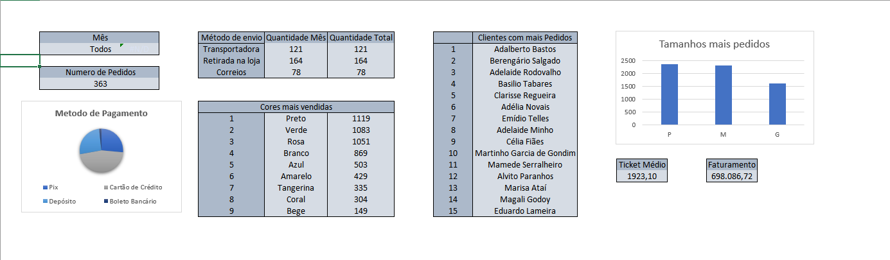

# 📊 Dashboard Analítico de Gestão & Indicadores (Excel)

> Painel analítico desenvolvido em Microsoft Excel com suporte a automações em VBA, tabelas estruturadas e visualizações dinâmicas para apoio à tomada de decisão.



---

## 📌 Sobre o Projeto

Este projeto consiste numa solução em folha de cálculo focada na centralização, tratamento e monitorização de indicadores operacionais e de desempenho.

A ferramenta foi desenhada para eliminar tarefas manuais de consolidação, oferecendo uma interface limpa, sem grelhas visíveis e com navegação estruturada.

---

## 🛠️ Tecnologias e Funcionalidades

- **Microsoft Excel (.xlsm):** Estruturação de dados relacionais e modelação em tabelas de apoio.
- **Visual Basic for Applications (VBA):** Rotinas para navegação rápida, limpeza de filtros e processamento de regras internas.
- **Cálculos e Modelação:** Fórmulas dinâmicas para agregação de dados e cruzamento de parâmetros.
- **Interface e Design (UX):** Painel executivo construído com foco em legibilidade, consistência visual e experiência do utilizador.

---

## 📂 Estrutura do Repositório

```text
├── assets/
│   ├── preview_dashboard.png    # Captura de ecrã da vista principal do painel
│   └── detalhes_analises.png    # Detalhe visual de tabelas e métricas
├── vba/
│   └── modulos.bas              # Módulos de código VBA exportados em texto puro
├── PAE - DGAE 2026 - Exercício Final.xlsm  # Ficheiro principal da folha de cálculo
├── .gitignore                   # Ficheiros temporários e de cache ignorados
└── README.md                    # Documentação do projeto
```

---

## ⚙️ Como Utilizar

### 1. Clonar ou descarregar o repositório

```bash
git clone [https://github.com/JGuilhermeG/nome-do-repositorio.git](https://github.com/JGuilhermeG/nome-do-repositorio.git)
cd nome-do-repositorio
```

### 2. Abrir o ficheiro

1. Abra o ficheiro `PAE - DGAE 2026 - Exercício Final.xlsm` no Microsoft Excel (versão 2019, 2021 ou Microsoft 365 recomendada).
2. Se surgir o aviso de segurança amarelo no topo da janela, clique em **"Ativar Conteúdo"** para que as macros e automações em VBA possam ser executadas corretamente.
3. Interaja com os botões de ação e filtros disponíveis no painel.

---

## 👤 Autor

Desenvolvido por **José Guilherme**
- GitHub: [@JGuilhermeG](https://github.com/JGuilhermeG)